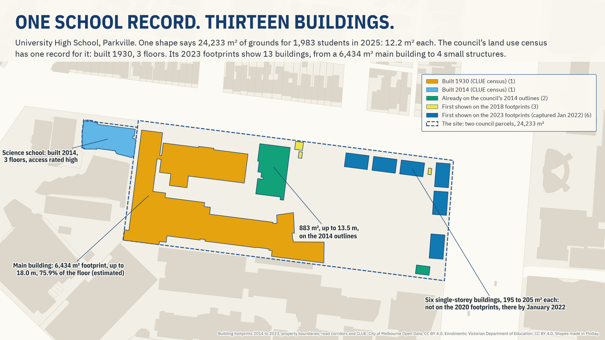
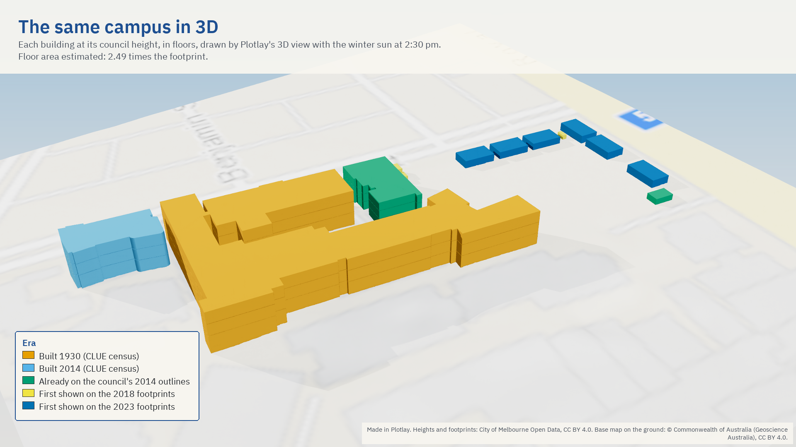
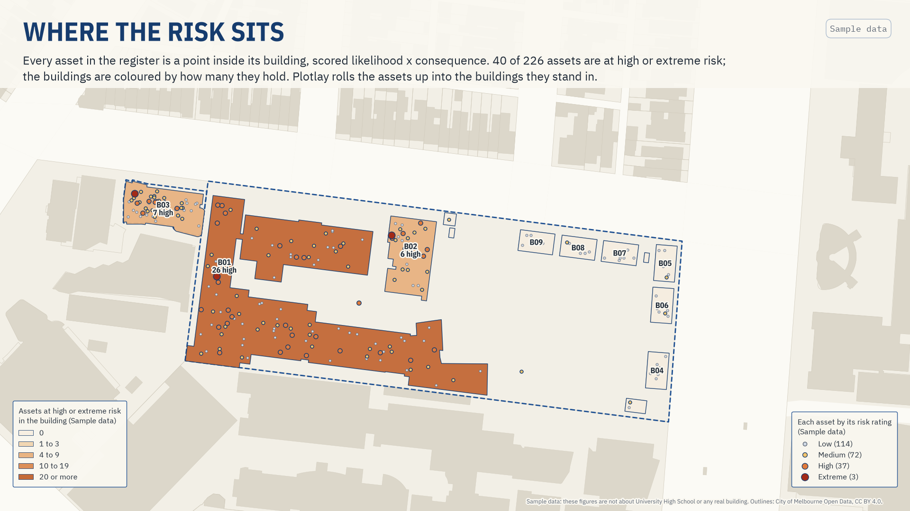
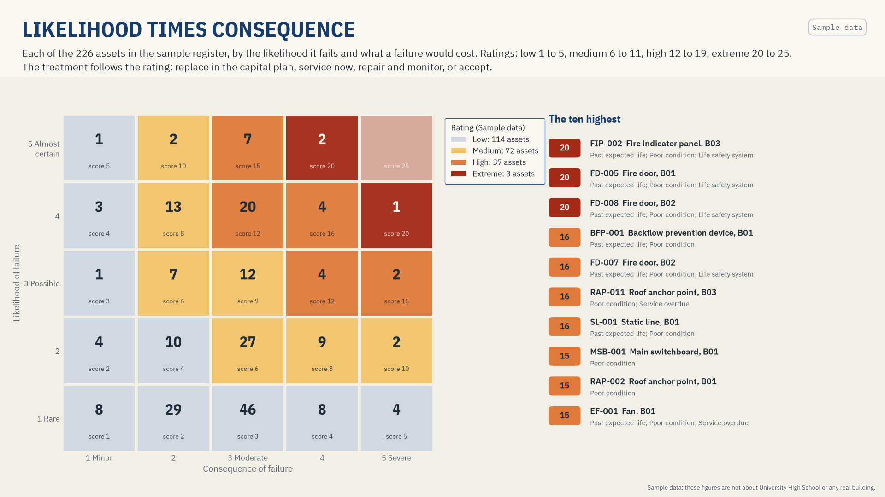
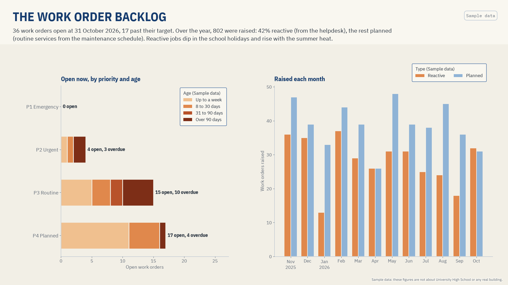
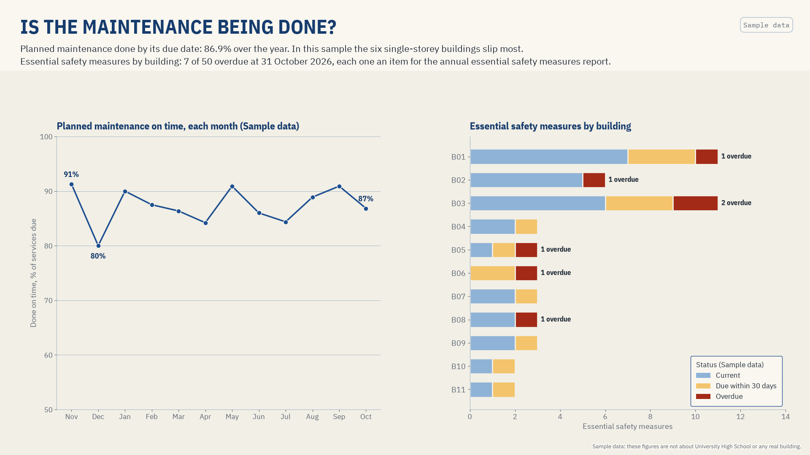
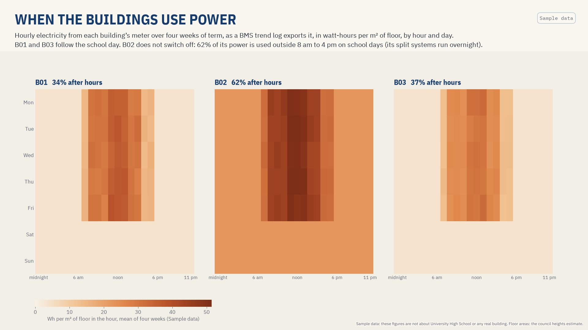

# One school campus, building by building

**What does one shape per school hide? One school drawn as its buildings, rolled up to the site, with estimated floor space per student.**

University High School in Parkville, Melbourne, reported building by building and rolled back up to the site. **Live version, with an interactive map:** [getplotlay.com/showcase/school-campus](https://www.getplotlay.com/showcase/school-campus/)

The other school maps draw one shape per school and divide its grounds (the land a school sits on, buildings included) by its students. That is a site-level figure. Here one government secondary school is drawn as its buildings, each its own shape with its own data, then rolled up to the site in [Plotlay](https://www.getplotlay.com) so the two can be compared.

**One shape says 24,233 m² of grounds for 1,983 students in 2025: 12.2 m² each.** Students here are February FTE enrolments (Victorian Department of Education), not a headcount. The City of Melbourne's land use census (CLUE) has one record for the school's property: built 1930, 3 floors. **The council's 2023 footprints show 13 buildings**: a 6,434 m² main building, a science school built in 2014, an 883 m² block, six single-storey buildings of about 200 m² each, and four small structures.

## What the data says

| | |
|---|---|
| The site (two council parcels as one shape) | 24,233 m² |
| Students, February 2025 (FTE) | 1,983 (1,210 in 2007, 65% more by 2026) |
| Buildings on the 2023 footprints | 13, footprint 9,484 m² (39.1% of the site) |
| Floor space (estimated), from the council's heights | 23,624 m² (2.49 times the footprint) |
| Per student, 2025: grounds / footprint / floor space (estimated) | 12.2 / 4.8 / 11.9 m² |
| The main building's share of the floor | 75.9% |
| Six single-storey buildings, first on the 2023 footprints | 1,195 m², 5.0% of the floor |
| Buildings with a CLUE record / an accessibility rating | 2 of 13 / 2 of 13 |

- **One record, thirteen buildings.** CLUE describes a building, and for this property it has one: University High School, built 1930, refurbished 2008, 3 floors, accessibility rated 2 of 3 (moderate). The science school has its own record (built 2014, 3 floors, rated 3, high). The other 11 buildings have none: no year, no floors, no accessibility rating.
- **Grounds are not floor space.** Plotlay's [Sydney schools showcase](https://www.getplotlay.com/showcase/sydney-schools/) measures grounds per student, one shape per school. Building by building, the estimated floor space per student (11.9 m²) is close to the grounds per student (12.2 m²), because three-storey buildings cover 39.1% of the site. Enrolments are the school's: they are divided at site level only, never split across buildings.
- **More students, the same grounds.** Enrolments rose from 1,210 in 2007 to 1,990 in 2026. Grounds per student fell from 20.0 m² to 12.2 m². Six single-storey buildings of 195 to 205 m², 3.7 to 4.0 m high with gable roofs, are not on the council's 2020 footprints and are on the 2023 ones (captured January 2022). Enrolment grew by 321 between 2020 and 2025.
- **Three quarters of the floor is one building.** The main building holds 75.9% of the estimated floor area. A site-level figure cannot say whether that floor is in a 1930 building or a new one; building by building it can.

### Read it carefully

- **Floor space is an estimate.** The council's 3D footprints give each part of a building a base and a top. At each square metre the height is the top of the highest part less the lowest base; storeys are that height (2 m less under a pitched roof) divided by 4 m floor to floor, rounded, at least 1, and never more than the CLUE floors where the census has a record for the building. It is a ranking and a scale, not a measured floor area.
- **Heights are the council's**: the top of a building's highest part above the lowest base of the structure. On a sloping site the uphill side reads a little taller. The main building is up to 18.0 m.
- **Era is not always a year built.** CLUE gives a construction year for two buildings. For the rest, the era is the first council layer that shows them (outlines 2014 and 2015, footprints 2018, 2020 and 2023). An early layer can leave out a small structure, so "first shown" is not "built".
- **One school, two parcels.** The site is University High School's parcel and the Elizabeth Blackburn School of Sciences' parcel, joined as one key. The science school is the school's branch for Years 11 and 12; the Department lists no separate enrolment for it, so its students are in University High School's figure.
- **Students** are the school's February FTE enrolments (Victorian Department of Education), not a headcount. The science school's students are in the figure.
- **Areas are approximate**: accuracy depends on the council's footprints and property boundaries the outlines came from. Every building's area matches the council footprint to within 0.148%.

## Sample data: facilities on the same buildings

`data/sample/` is sample data: the figures are not about University High School or any real building. It shows what a facilities team links once each building is a keyed shape, in the shape a CAFM or CMMS exports it: an asset register of 226 assets as points inside the buildings (Plotlay's facilities asset types and tags), condition and remaining life, risk as likelihood times consequence, twelve months of work orders, planned maintenance compliance, essential safety measures, the asbestos register, a BMS trend log of the building meters, space use and a capital works backlog. In the sample, 40 assets rate high or extreme, 36 work orders are open (17 overdue), 86.9% of planned maintenance was done on time, and the capital works backlog is A$3.9M.

Everything was drawn from one fixed seed; [`data/sample/README.md`](data/sample/README.md) is the data dictionary and says how each column was made. `data/sample/handover/` is the building handover pack Plotlay makes from it (COBie, IFC, Project Haystack, Brick), with the buildings taken from the sample buildings layer and no rooms drawn. The notebook reads the sample only in its last section; the Power BI project has three sample pages (risk, work orders, compliance), each tagged Sample data. No real figure, chart or total uses it.

| | |
|---|---|
|  |  |
|  |  |

## How it was made with Plotlay

1. **A map project** on the Geoscience Australia base map, and two **Data layers**: Campus site and Buildings.
2. **Start from the data.** The enrolments table linked to the empty Campus site layer, and the buildings table (13 rows, keyed B01 to B13) linked to the empty Buildings layer: every row became one to place.
3. **Pick from a layer.** The council's property boundaries (parts joined by `property_id`) and 2023 building footprints (parts joined by `structure_id`) added with their licence. A click takes the outline under it and gives it the row's key. The two parcels became parts of one site key.
4. **A time axis.** Each building's footprint on the council's 2014, 2015, 2018, 2020 and 2023 layers linked as a long table: the slider shows the buildings appear.
5. **Colour** by era, by estimated storeys, and by floor area **divided by** footprint.
6. **3D at the real heights**: each building at its council height in metres, in floor plates from its storeys.
7. **Roll up** the buildings to the site: how many, their footprint, their floor area, the earliest first mapped. Formulas then give grounds and floor space per student at site level.
8. **Sample data** on copies of the outlines, in layers of their own: the register's assets keyed by tag and rolled up into the buildings and the site, work orders month by month, the meters' trend log imported onto the buildings by key, and the handover pack from the buildings layer.
9. **Export** GeoJSON, TopoJSON for the Power BI Shape Map, CSV with WKT, the linked data and a Python starter. Nothing in this repository comes from OpenStreetMap or from aerial imagery.

## What's here

| Folder | What |
|---|---|
| [`data/geometry/`](data/geometry) | The buildings (key B01 to B13) and the site (key UHS) from Plotlay: GeoJSON, TopoJSON, CSV with WKT |
| [`data/buildings/`](data/buildings) | `buildings.csv` (one row per building: footprint, height, roof, era, storeys and floor area estimated, the CLUE record where there is one), `footprint_by_year.csv` (each building on each council snapshot) |
| [`data/site/`](data/site) | `enrolments.csv` (2007 to 2026), `clue_records.csv` (the two CLUE records, every census year 2002 to 2024), `site_rollup.csv` (the site's roll-up from Plotlay) |
| [`data/sample/`](data/sample) | **Sample data**: eleven facilities tables keyed to the buildings and assets, the data dictionary, the outlines they sit on, and the handover pack made from them |
| [`python/`](python) | `campus_buildings.ipynb`, executed: every number above worked out from `data/` |
| [`powerbi/`](powerbi) | `SchoolCampusBuildings.pbip`: a Power BI Project (open [`OPEN-ME.md`](powerbi/OPEN-ME.md) first) |
| [`visuals/`](visuals) | The hero map, the 3D view, the charts, and the sample maps and charts (each tagged Sample data), 16:9 and 1:1 |

## Sources and licence

Code (the notebook, the Power BI project): MIT ([`LICENSE`](LICENSE)). Data we made (the shapes, tables and estimates): CC BY 4.0 ([`LICENSE-DATA`](LICENSE-DATA)). Upstream: City of Melbourne Open Data (building outlines 2014 and 2015, building footprints 2018, 2020 and 2023, property boundaries, CLUE building information), CC BY 4.0; Victorian Department of Education, All Schools FTE Enrolments, CC BY 4.0. Full credits in [`NOTICE`](NOTICE). Nothing here implies endorsement by the City of Melbourne, the Department of Education or the school.

Made with [Plotlay](https://www.getplotlay.com): maps, plans and data layers for Power BI and Python.

## The other schools showcases

- [Sydney schools](https://www.getplotlay.com/showcase/sydney-schools/): grounds per student across 81 inner Sydney and Parramatta government schools (2025 headcount), one shape per school.
- [NSW and SA schools side by side](https://www.getplotlay.com/showcase/schools-nsw-sa/): the same grounds method within 7 km of the Sydney and Adelaide town halls (2024 headcount), plus spending, staffing and outcomes for each state.
- [Inner Sydney High, a deep dive](https://www.getplotlay.com/showcase/inner-sydney-high/): a 14-storey vertical school, measured by its estimated floor space per student over its staged opening.
